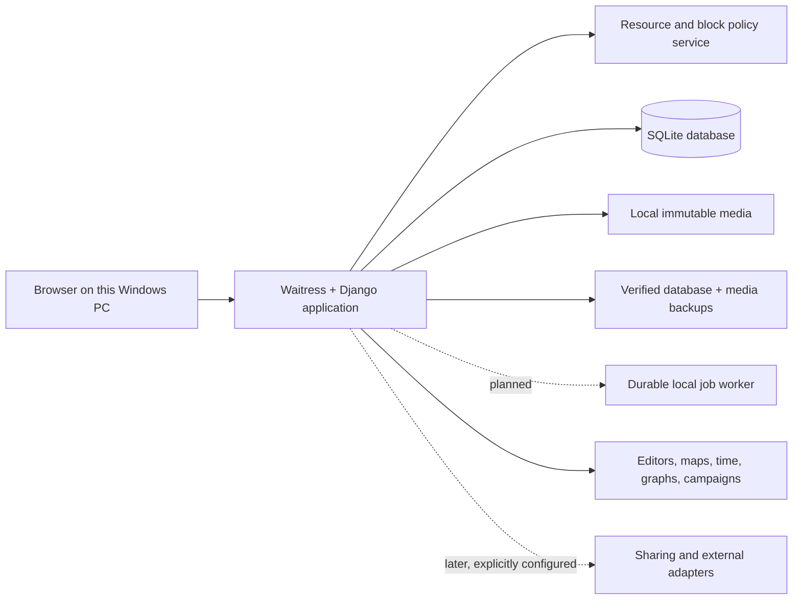

# Architecture: current release and full-scope target

Status: current local architecture reviewed 13 November 2026; application milestone 1.0.0. Detailed target models below are not all current database tables. See implementation-status.md and status-audit.md for separated delivery/test coverage.

## Deployment decision

The user selected **only me on this Windows PC**. The first release therefore runs natively on Windows, serves the browser on `127.0.0.1`, and stores its database and media locally. The runtime is designed to use local assets without a cloud dependency. Physical network-disconnected create/edit/search has not been verified; external image URLs need their hosts. No Docker, external database server, subscription, CDN, or cloud account is required for everyday use. Initial dependency installation and subsequent updates may require internet access unless distributed as a bundled installer.

Normal integrated use starts with npm start in Aina; the managed host does not open a new browser. The optional standalone launcher may open one when the user explicitly runs it. First-run setup creates an owner account; a persistent local session avoids repeated logins. Network sharing remains disabled unless deliberately configured in a later deployment profile. Adding publication and collaboration does not make existing private content public automatically.

## Components

| Component | Proposal | Reason and implementation boundary |
| --- | --- | --- |
| Browser interface | React + TypeScript, compiled and served locally | Shared editors and widgets; no Node development server needed at normal runtime. |
| Application | A supported Django LTS release | Database migrations, validation, authentication, transactions and administration. Object/block policies are our responsibility; Django does not automatically provide them. [Official permissions documentation](https://docs.djangoproject.com/en/5.2/topics/auth/customizing/#handling-object-permissions). |
| Windows HTTP server | Waitress | Native Windows-compatible serving rather than relying on Django's development server. [Official documentation](https://docs.pylonsproject.org/projects/waitress/en/latest/). |
| Local database | SQLite, with short transactions and a search adapter | Appropriate initial deployment complexity for one local user. Django supports SQLite and PostgreSQL, but database-specific features require explicit adapters and migration tests. [Database documentation](https://docs.djangoproject.com/en/5.2/ref/databases/). |
| Search | SQLite FTS5 plus normalized title/alias matching | Use Unicode-aware indexing; short CJK names need explicit exact/prefix/substring behavior. Verify FTS5 availability during setup. [FTS5 documentation](https://www.sqlite.org/fts5.html). |
| Rich text | Tiptap's open-source core and application-owned extensions | Store structured documents with stable resource references. Paid cloud features and commercial extensions are not required or assumed included. [Core license](https://github.com/ueberdosis/tiptap/blob/main/LICENSE.md). |
| Maps | Leaflet image-coordinate maps | Match image annotation and linked exploration without a paid basemap API. A procedural map painter is an additional feature, not baseline map parity. [Image-coordinate example](https://leafletjs.com/examples/crs-simple/crs-simple.html). |
| Relationships | Current: application-owned SVG graph and family/diplomacy layouts. Future option: React Flow | A rendering/editor library does not supply genealogical or diplomatic semantics; we implement those. [Official documentation and license link](https://reactflow.dev/learn). |
| Whiteboards | Current: application-owned note/card/connector canvas. Future option: Excalidraw | Link cards to world records; persist the scene and asset references locally. Its hosted service is not part of this dependency. [License](https://github.com/excalidraw/excalidraw/blob/master/LICENSE). |
| Long jobs | Planned: local durable job table and a small worker; current operations are synchronous and bounded | Imports, exports, thumbnails and backups resume or fail visibly; no Redis service needed initially. |
| Later shared server | Optional PostgreSQL, an appropriate server transport and HTTPS proxy | Explicit future profile; migrations, deployment and multi-user load must be tested before enabling sharing. |

Python runtime dependencies are pinned in requirements.lock; browser dependencies are locked in package-lock.json. This release uses the locally installed bundle, with no CDN. The future-library rows are alternatives, not installed dependencies.



## Current schema and full-platform target

Current Django models are User, World, Resource, Revision, Connection, Asset and Activity. Typed module fields live in validated Resource.data JSON. The following expanded model catalogue is the full-platform target; memberships, audiences, worker jobs, sheet packs and releases are not implemented yet.

The foundation is a resource registry, not a database of unrelated module blobs. Resources have opaque stable IDs, a kind, an owning world or personal owner, lifecycle state, revision and policy. Specialized tables and validated structured fields supply the domain details. Relational keys remain real relationships; configurable content is stored as validated JSON where appropriate.

| Model | Purpose |
| --- | --- |
| User / World / WorldMembership / AudienceGroup | Ownership, authoring roles and reader grants. Personal notebooks have user ownership independent of world membership. |
| Resource / Alias / Tag / CategoryPlacement | Stable identity, names, discovery and organization across every module. A category's primary parent is distinct from secondary collections. |
| Document / Block / ResourceRevision / PublishedRevision | Rich content, separately authorized blocks, draft history and an explicit published snapshot. |
| Template / TemplateVersion / FieldValue | Original article schemas, repeatable sections and custom form validation. Schema changes need migrations rather than silently resetting values. |
| Relation / RelationType / GraphView | Shared kinship, diplomacy, affiliation and custom relations. A graph stores layout and filters, not duplicate characters. |
| Asset / AssetVersion / AssetUse | One media library, immutable source versions, credits and reference tracking. A map, article and handout can reuse the same image. |
| Map / Layer / Marker / Geometry / MarkerGroup | Interactive image annotation with typed geometry and separate access controls. |
| Calendar / Era / HistoricalEvent / EventPlacement / Chronicle | Shared fictional-time definitions and reusable events, separate from real session schedules. |
| Campaign / Party / Participation / Quest / Session / HandoutState | Session preparation and play using the same world entities. |
| SystemPack / SheetSchema / Statblock / CharacterProfile / InventoryEntry | Versioned rules support, homebrew, character ownership and assets. A player profile can reference one existing lore character. |
| Notebook / Section / Note / Task | Personal capture, metadata and article-linked planning. |
| TableDefinition / TableRow / Generator / VariableCollection | Typed data, deterministic rules, weighted selection and reusable fragments. |
| Manuscript / Chapter / Scene / Release | Writing hierarchy, private drafts, release ordering and reader views. |
| Revision / TrashEntry / AuditEvent / ImportRun / Job | Recovery, provenance, visible operation state and troubleshooting. |

Example: one NPC can have a lore article, appear in a family tree, have a marker on a map, belong to a party, hold a statblock, and participate in historical events. Those views reference the same NPC ID. Renaming the NPC changes its visible name everywhere; private notes retain their own policy.

## The fictional-time engine

Ordinary browser dates are not sufficient for fantasy history. Store a calendar definition, signed ordinal date, subday fraction, precision and any uncertainty/original notation. Historical ranges can be approximate or open ended. Support named eras, year-zero policy, leap rules, intercalary days, repeating festivals and multiple celestial cycles.

Conversions between two calendars require an explicit shared epoch/mapping; unrelated calendars must not silently compare as if they share an origin. Calendar grids, historical ordering and Chronicle map states use this same engine. Actual session scheduling uses real timestamps and the user's timezone (currently Asia/Singapore), not fictional date values.

## Content and permissions

Authoring roles answer who can create/edit/publish. Audience grants answer who can read a resource or block. They are separate questions. Reusable secrets also have GM-only notes whose visibility is unchanged when a secret is revealed.

Every access path must use the same policy: HTML pages, APIs, media downloads, search suggestions and snippets, graph expansion, map markers, exports, feeds and later live events. Hiding content with CSS is insufficient. Public counters and cached renders also need audience-aware behavior. Restricted content must be removed before a response is serialized.

The local first release uses an owner account, but development tests include owner, writer, reader and outsider identities from the beginning. This prevents later player access from requiring a privacy rewrite. If simultaneous editing is added, restricted blocks must not share an unrestricted collaboration document or initial state.

## Editing and extension boundaries

The internal format is a versioned document tree, not raw HTML. Mentions, embeds and variables point to stable IDs. HTML/Markdown/BBCode importers translate into that tree and retain the original source. Unsupported constructs produce a migration report. Export must preserve unknown/raw source so an importer limitation does not destroy the user's work.

Custom templates use declarative schemas and layouts. Formulae and generators use a bounded expression language, not arbitrary Python or JavaScript. Allow repeaters, calculated fields, conditional sections, weights, reusable variables and nested generators with limits on depth and work. Advanced presentation uses scoped CSS and sanitized markup. Installed system packs record their versions and provenance.

## Disk layout and recovery

Proposed runtime layout:

```text
WorldBuilder/
  README.md
  docs/                       Research, requirements and decisions
  backend/                    Django app and domain services
  frontend/                   React app and shared widgets
  scripts/                    Setup, launch, restore and verification helpers
  data/
    worldbuilder.sqlite3
    media/
    backups/
  .venv/                      Local Python environment
```

Runtime data, credentials and environments stay outside Git. Browser storage may help recover an interrupted draft but is not the authoritative database. All acknowledged saves go to disk. Updates snapshot data before migrations and include a tested rollback procedure; blindly downgrading a changed database is not a rollback plan.

Backups must include a consistent database snapshot plus every referenced immutable media version, a schema version, checksums and a restore manifest. Use SQLite's backup mechanism rather than copying only an active database file; coordinate media retention while creating the archive. [Python backup API](https://docs.python.org/3/library/sqlite3.html#sqlite3.Connection.backup). Completion requires restoring to a clean directory and verifying links, settings, secrets and asset hashes.

## Initial interface direction

Use readable type, adjustable panel widths and a content-first workspace. Primary areas: World, Library, Maps & History, Relationships, Campaigns, Writing, Notes, Media and Settings. Advanced modules can be hidden from navigation without disabling their data. Start with a small set of representative workflows and real campaign samples; validate desktop screenshots and keyboard interactions before expanding the UI.

The project is independent of `Character Creator`. Portrait composition is not a World Anvil feature-equivalence requirement. WorldBuilder can attach an existing image without importing that tool or its interface.

## 0.2 organization and deployment additions

Assets now store tags and a metadata revision. Collection definitions remain Resource records: physical collections use parent relationships, while saved filters derive membership from current metadata. Reader membership is separately evaluated against published snapshots; owner media membership does not imply a reader grant.

SQLite IMMEDIATE transactions reserve the write lock before hierarchy validation, then apply revision checks and writes together. Bulk organization preflights the final parent graph and saves parents before descendants. Reference previews cache by world and revision, and creating a missing linked article does not replace the editor's document.

`WORLDBUILDER_BUNDLE` may select a staged browser bundle for isolated QA. Release builds are tested against `.preview/qa-data` before replacing `dist`. The native launcher takes a complete backup before applying pending database migrations.

## 0.3 maps and history

Named timelines are Resource records that reference shared event IDs, so edits update every placement without copying events. Calendar arithmetic and its inverse are centralized on the server; lanes, duration bars and Chronicle playback consume the same filtered history projection. Unrelated calendars require separate axes. Existing dates that no longer fit a changed calendar are retained with warnings rather than silently converted.

Maps store coordinates and view centers relative to image dimensions. Layers resolve through the world media registry. Published map projections remove private layers, groups and grouped markers before rendering. Published history projections remove private timeline tracks and unavailable references. Deleting a private map group retains privacy on its formerly grouped markers.

The local reader renderer is still an owner preview. The confirmed later shared-hosting profile requires separate accounts, memberships, player/group grants, protected media and permission-aware relationship edges. Those decisions and release continuation rules are retained in [project-tracker.md](project-tracker.md).

## 0.4 historical map state

Maps retain independent dated scenes in their existing Resource data, avoiding a schema migration. Scenes reference immutable world assets and copy normalized geometry/settings. One server projection selects an effective scene using an event's calendar and start date; owner Chronicles and saved reader timeline embeds consume that projection. Reader filtering precedes version selection, and mismatched calendars never imply a date conversion. Existing dates survive calendar edits with warnings, while new dates require validation.

Map revision/conflict protection, published snapshots, Trash, revision restoration and portable archive remapping also cover the historical scenes. Capturing from a private version retains its private flag. Full scenes trade storage for independent editing; the existing per-record JSON size limit still applies in addition to the 100-version limit. Versions do not interpolate geometry or transform an image's coordinates.

## 0.5 family graphs and content hierarchies

Family traversal and hierarchy membership are server projections. Reader filtering occurs before traversal so a hidden parent cannot act as a bridge to reveal a restricted branch, edge label or endpoint. Family diagrams assign one node per resource identity and use parent-path ranks; accessible lists show the same nodes with full names. Adoption is explicit in bloodline queries. Parent/spouse/sibling/guardian relationships remain shared Resource references rather than copied character records.

Parent-link creation now reserves SQLite's write transaction before checking ancestry, including adoptive links. Concurrent opposite-edge insertions cannot both pass the check. Imported legacy cycles produce bounded display warnings instead of repeated nodes. Connection visibility is live and notes remain owner-only; independent connection revision history is future work.

Content hierarchies live in the existing tree Resource data. Explicit parent mappings and ordering are independent of collections and inherit Resource revisions, publication and recovery. Legacy definitions without explicit parent mappings retain their collection-derived display. Selection can combine manual references and normalized tags; reader membership uses published tags. Archive remapping includes both the child keys and parent values of the mapping. No database migration is needed for 0.5.

## 0.6 reusable graphs and exports

Saved relationship filters are Resource records of kind `relationship`. They reference source identities rather than copying people or edges. Family traversal can consume a tag/type-filtered registry, while network/diplomacy modes project eligible edges and optional isolated entries. Reader filtering precedes traversal and unavailable roots never fall back to an unrestricted family graph.

A shared projection supplies app diagrams/lists and graph attachments. SVG is built with an XML serializer; HTML escapes all labels and contains a fixed, hash-authorized script for local controls. No source article bodies or GM/connection notes enter that projection. JSON, SVG and HTML share the same eligible node/edge sets. Standalone HTML has no dependency on the app, browser storage or HTTP assets, and remains a fixed copy after download.

Reader exports combine published view/source snapshots with live connection visibility. A saved graph's source changes can therefore alter later exports without changing its filter definition. The editor flushes pending Resource changes before export. Attachment responses remain local-owner authenticated; no public publishing, account access or iframe exception was enabled. No schema migration is required.


Release 0.7 adds `calendar_engine.py` behind the existing tools wrappers. All calendar previews, event ordinals, history ticks and dated map selection use this engine. It counts offset periodic leap rules without iterating years, inverts ordinals with bounded binary search, and computes celestial phases from the same day ordinal. Calendar interchange whitelists mathematical settings; imports use the ordinary private Resource/revision model. No schema migration is required. Map symbols use fixed DOM-built SVG geometry or local validated raster assets, with reference validation applied recursively to dated scenes. See `api.md` for limits and `validation-0.7.md` for verification.


Release 0.8 adds `historical_dates.py` for precision-aware labels, normalized lower date tuples and inclusive upper bounds. History, full resource date contexts and map-state lower-bound selection use these helpers. Independent era resources use the existing JSON, revision and immutable publication model; event links are validated in the same write transaction. Reader context filtering removes unavailable era identities before projection. Ongoing eras retain a null upper bound rather than an invented present date. No schema migration or external dependency is required.


Release 0.9 adds bounded ordinal/month/year recurrence projection in `recurrence.py`. Source filtering precedes expansion; source UUIDs remain stable while occurrence keys distinguish timeline selection. Map requests validate occurrence membership directly instead of trusting browser dates or a truncated preview. Event and calendar date lists share the history projection and audience snapshots. Candidate/output budgets bound unending or sparse rules; warnings expose incomplete previews. A recurrence keeps its source record and fixed-day duration, while full bodies are fetched separately rather than copied per occurrence. No schema migration is required.


Release 0.10 adds revision-checked connection writes in connection_history.py, with SQLite IMMEDIATE transactions covering fetch/validation/mutation/history. ConnectionRevision snapshots are immutable through the API. Soft-deleted connections are filtered before family/saved graph projection; reader details apply the same filter and omit notes/history metadata. Portable archives preserve/remap connection snapshots and timestamps; migration 0003 seeds existing records with baseline history. Migration preservation checks compare original columns rather than demanding identical schema hashes.

SearchableSelect is the shared frontend control for all 97 select locations, retaining a hidden native control for existing form/change behavior. Its searchable list is portaled into the current modal or document body, with keyboard selection/cancellation/focus handling and viewport-bound placement. An AST guard in check/build prevents new raw selects. This requirement is USER-01 in the inventory, additional to its original scope rows.


## Location guides (0.17)

Character dossiers and location guides share the entry_dossier audience projection and dossier UI. Location mode validates settlement/building/geography article templates, adds directional resident cards and map/pin-based record associations, and permits campaign location context through an eligible map. Hidden-pin records are excluded before matching and linked-session expansion in reader mode. Original records and relationships retain their UUIDs and normal version/archive handling; derived visits are not persisted. Location-specific route/reader wrappers reuse the same searchable controls, private composer and focused map component.


## Connected campaign workbench (0.18)

The owner-only workbench projects original versioned campaign records into a saved GM desk, visual status board and searchable notebook. CampaignCapture is shared by the workbench and thread guide; ThreadFields is shared by the thread guide metadata form and original editor. Desk metadata lives in private campaign gm_workspace, validated before normal saves/history restoration and recursively remapped by portable archives. GM metadata is removed by the common reader projection and reader search. It must remain owner-only when future player accounts/grants are introduced.

All record mutations use existing revision-checked resource APIs. Pins store source IDs and presentation settings, avoiding stale copied prose. New captures start private; follow-up pinning/refresh errors are distinguished from failed record creation. Full-body filtering and pagination run on the server within campaign/session boundaries. Thread objectives and progress are independent, with published outcomes and separate GM-only next actions. No new tables/dependencies are required.


Release 0.19 connects ten preparation/play/review features through planning.py and the existing Resource/revision/archive model. Four article planning types avoid changing the manuscript scene module. Adventure grouping/order/positions and branch/prerequisite references describe reusable definitions; agenda states belong to individual sessions. Capture keeps scene/session/map/cast provenance. Follow-up scheduling and task conversion retain originals. Handoff locks and revision-checks source/target and schedules follow-ups in one transaction; a rejected action creates no orphan session or duplicate task.

The lifecycle projection is owner-only, campaign scoped and bounded. Reader serialization strips all GM planning/running data before rendering/search/export. Handout preview/export uses published source projections even for an owner preview; its introduction and images are explicit approvals. HTML exports embed validated local images and retain no browser-storage dependency. Public online access remains P5.

ReferenceTray stays mounted alongside the current page. It retains source UUIDs/selection in per-world localStorage, fetches originals, and restores connected editor focus/DOM range when folded. It does not navigate or flush/unmount the editor for inspection. Tray preferences are browser local and are not included in world archives. All dropdowns use the shared searchable control. No dependencies, tables or migrations were added; schema 0003 remains current.


## Database-backed continuity in 0.20

The live Windows database is data/worldbuilder.sqlite3. SQLite uses a 20-second busy timeout and IMMEDIATE transactions. Resource rows store document/structured details in JSON database columns with world/parent foreign keys and revision numbers; Revision stores snapshots, Connection/ConnectionRevision store relational edges/history, Asset stores image metadata, and Activity stores changes. New JSON reference fields are application-validated for world/type/campaign ownership. This is server-side persistence; browser storage is limited to preferences and draft recovery. No new table/dependency/migration is needed for the continuity types.

continuity.py projects campaign-scoped party/equipment/record/media/quest data. Party profiles reference original characters; reusable lore is never duplicated for promotion. Progression, consequences, relationship events, journeys, place status, media collections and wrap-up are versioned original resources. Stock actions lock and revision-check an item, validate nonnegative integer holdings, update its quantities and create a private movement resource in one transaction. New rewards also revision-check/bump the campaign to prevent duplicate creation on replay. Ordinary patches cannot alter stock or movement facts; inventory identity/campaign stay fixed. Item-note revision restoration preserves current holdings. Trashing a movement is not a stock undo.

Relationship changes use existing connection revision/history services in the same transaction as the source event. Wrap-up saves reviewed source UUID/revision pairs and its session reference atomically; completing a session finishes its active item while leaving other planned/skipped states intact. Current party/equipment state is separate from session-filtered event history. Reader projection removes GM continuity metadata, ownership, profiles, routes, collections and review details even after deliberate publication.

Quest objective nodes resolve to the original quest for inspection. Saved position keys use original UUID/objective ID; portable archives remap those compound keys, stock holders, nested media/journey/review references and relationship IDs. Relationship IDs are allocated/imported before validating event references, with duplicate-ID protection and complete transaction/file cleanup. Backup restore retains the database/history; a portable world keeps source relationships with newly remapped IDs.

## Original-source notebooks in 0.21

Notebook and template containers are private article Resource rows distinguished by data.notebook_type. Ordered sections contain original Resource UUIDs and optional parent section UUIDs, not duplicate text. Rich templates copy a versioned document/schema into independent private captures. Metadata, favorites, knowledge categories, board geometry and labeled card edges remain validated JSON in the same SQLite database. No new dependency, model, table or migration was introduced.

Notebook actions commit inside a transaction. Capture UUID/fingerprint replay protection prevents duplicate retry notes, and optional section filing shares that transaction; stale book writes cannot orphan a capture. All affected originals are revision-checked before bulk mutations. Board drafts save explicitly, retain text/positions on conflict and require explicit discard before reloading. In-place writing reuses the original editor/autosave/history; reference previews keep that editor mounted and restore its cursor. Detailed source fields use metadata/full-editor actions so the embedded workspace puts writing first.

Reader serialization strips notebook organization, capture identities, template defaults, favorites and custom metadata. Published-source HTML export uses published source snapshots and generic notebook/section headings, excludes private blocks/GM notes, escapes labels and embeds only same-world media within a 30 MB limit. Private export is explicitly selected. Both are owner-authenticated downloads with restrictive CSP, not online publication. Read-only audits report unavailable explicit references and ambiguous names without mutating originals. Existing archive UUID remapping preserves nested sections, templates and boards; notebook metadata field and section IDs remain internal identities.

## Graph input, linked media and portability in 0.22

Shared GraphNavigation binds a non-passive wheel listener and captured middle-button pointer gestures to SVG viewboxes. Zoom anchors use the inverse SVG screen matrix, preserving letterboxing and pointer location; pan changes only the camera. Original node geometry still uses existing revision-checked saves. Graph menus operate on actual source/edge identities, hide owner actions in reader mode, use measured viewport placement, dismiss on outside click/scroll/resize, and handle Escape without dismissing surrounding dialogs. All-connections/diplomacy now use the shared NodeDiagram instead of a separate static SVG.

Markdown conversion uses the existing server parser/sanitizer through an authenticated parse-only endpoint. Paragraph/heading images are lifted to editor-compatible blocks without dropping surrounding text/marks; list items retain the required leading paragraph. Insertion appends at the current selection, preserving the rest of the original document. Rich JSON remains authoritative; this is not lossless Markdown source roundtripping.

Image URLs accept same-world local media or validated HTTP/HTTPS addresses; executable/data/file/protocol-relative/credential-bearing/malformed URLs reject. The browser CSP permits HTTP/HTTPS images while retaining same-origin scripts/connections and blocked frames/objects. No server URL fetching/proxy was added. Portrait URLs use validated data.cover_url, alongside cover_asset, and reader graphs/guides derive them from the published snapshot. External hosts can still block embedding; offline/backup portability requires uploading a copy. Notebook HTML retains remote image URLs with an image-only remote CSP allowance.

The transfer packager allowlists application source/build/setup files and embeds a verified complete database/media backup, instructions and a new-folder restore launcher. It excludes runtime environments, caches, QA data and environment files. Payload checksums are verified before reporting success. The destination runs Setup to create its own environment and restores into a new data folder; accounts/password hashes/history persist, existing destinations are protected, browser preferences are not transferred. No database schema or dependency changes were needed.
